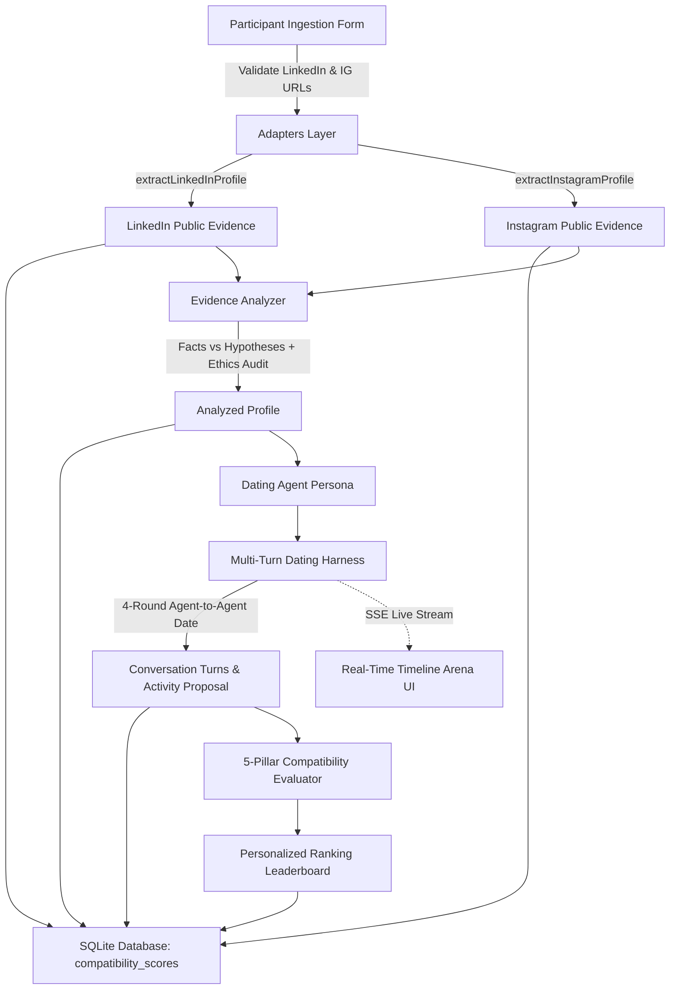

# AuraMatch AI — Agentic Dating & Compatibility Platform

> **3-Hour Challenge Implementation**: An autonomous, dual-source agentic dating platform where each participant is represented by an AI agent synthesized strictly from their public LinkedIn and Instagram profiles. Agents date other participant agents through multi-turn conversations, propose compatible activities, independently evaluate continuation, and produce personalized compatibility rankings backed by persisted evidence.

---

## 🌟 Key Features

1. **Dual-Source Ingestion & Strict URL Validation**
   - Mandatory public LinkedIn profile URL (`https://www.linkedin.com/in/username`) and public Instagram profile URL (`https://www.instagram.com/username`).
   - Normalization and validation preventing invalid paths or reserved words.
2. **Platform Access Control & Compliance Adapters**
   - Independent LinkedIn and Instagram extraction adapters.
   - Respects rate limits, robots policies, and platform login-walls. Never bypasses authentication, cookies, or CAPTCHAs.
   - Distinguishes between `live_extracted`, `restricted_login_wall`, and `fixture_snapshot` with full audit logs and timestamps.
3. **Structured Profile Synthesis & Ethical Guardrails**
   - Separates **Observed Facts** (anchored by verbatim quotes and signals) from **Hypotheses** (inferred tendencies with confidence levels).
   - **Zero Hallucination of Romantic Intent**: Refuses to claim romantic intent unless explicitly evidenced in public sources.
   - **Sensitive Traits Safety Audit**: Rigorously excludes religion, politics, ethnicity, medical conditions, and sensitive attributes.
4. **Persistent Autonomous Dating Harness**
   - Multi-turn agent-to-agent dialogues (4 distinct rounds: Introductions, Downtime & Rituals, Core Principles & Craft, Activity Proposal & Continuation).
   - Every turn tags the exact profile evidence used to ground the dialogue.
   - In Round 4, agents propose contextualized activities (e.g. coffee roasteries, trail runs, jazz lounges) and independently decide whether to continue.
5. **5-Pillar Compatibility Scoring Engine**
   - **Shared Interests** (0–30 pts)
   - **Preference Alignment** (0–25 pts)
   - **Complementary Goals & Synergy** (0–20 pts)
   - **Conversation Quality & Sentiment** (0–15 pts)
   - **Data Confidence Weight** (0–10 pts)
   - Dynamic mutual interest indicators: `MUTUAL_MATCH`, `ONE_WAY_INTEREST`, `POLITE_ACQUAINTANCE`, `INCOMPATIBLE`.
6. **Personalized Ranking Dashboard**
   - Select any participant to view their customized compatibility leaderboard, 5-pillar score breakdowns, explanations, and direct links to full transcripts.
7. **Real-Time Dating Simulation Arena & Replay**
   - Watch live dates stream in real time via Server-Sent Events (SSE) with adjustable playback speed (1x, 2x, 4x) or replay saved matches.
8. **25-Person Verified Public Figures Demo Dataset**
   - Pre-populated with 25 real, verified figures (Satya Nadella, Mira Murati, Marques Brownlee, Simone Giertz, Lex Fridman, Timnit Gebru, Andrej Karpathy, Fei-Fei Li, etc.) with real public URLs, dual-source extractions, and over 75 persisted dates.
9. **Offline Fallback & Zero Paid API Dependencies**
   - Runs out-of-the-box with a deterministic offline reasoning engine.
   - Optional local LLM support via Ollama.

---

## 🛠️ Technology Stack

- **Frontend**: React 18, Vite, TypeScript, Lucide Icons, Vanilla CSS Design System (dark luxury glassmorphism, Outfit & Plus Jakarta Sans typography)
- **Backend**: Node.js 20, Express, TypeScript (`tsx`)
- **Database**: SQLite with `@libsql/client` (persistent local database at `data/dating_platform.db` with WAL mode)
- **LLM Engine**: Deterministic Offline Reasoning Engine with optional local Ollama integration (`USE_OLLAMA=true`)
- **Testing**: Node.js built-in test runner (`node:test`) with TypeScript

---

## 🚀 Quick Start & Exact Run Commands

### 1. Prerequisites
- Node.js >= 18 (Tested on Node v20.11.1)
- npm >= 9

### 2. Installation
```bash
# Clone and enter directory
cd "d:/internship OA"

# Install dependencies
npm install
```

### 3. Environment Configuration
The application comes preconfigured with `.env`. If needed, copy `.env.example`:
```bash
cp .env.example .env
```

### 4. Seed 25-Person Verified Demo Dataset
```bash
npm run seed
```
*Note: If the SQLite database is empty when the server boots, it also auto-seeds automatically.*

### 5. Run Development Servers (Backend + Frontend)
```bash
npm run dev
```
- **Backend API**: `http://localhost:3001`
- **Frontend App**: `http://localhost:5173`

### 6. Run Automated Tests (With Isolated Test Database)
```bash
npm test
```
All 13 automated test suites execute against an isolated temporary database (`data/test_dating_platform.db`), ensuring the primary demo database (`data/dating_platform.db`) is never polluted by test participants.

### 7. Production Build & Execution
```bash
# Compile client bundle to dist/client
npm run build

# Start production server (serves frontend bundle & REST/SSE API on port 3001)
npm start
```

---

## 📹 3-Minute Video Demonstration Script

Target demonstration timeline ($\le$ 180 seconds):
1. **0:00–0:20 (Overview & Directory)**: Introduce AuraMatch AI; show the editorial Discover view and People Directory with 25 canonical demo participants and 75 persisted dates.
2. **0:20–0:55 (Dual-Source Ingestion & Provenance)**: Open "Add Participant"; paste LinkedIn and public Instagram URLs; observe URL validation; inspect extraction status view showing truthful badges (`Live Retrieval Successful`, `Curated Demo Fixture`, `Restricted by Login Wall`) and zero hallucinated traits.
3. **0:55–1:55 (Autonomous 4-Round Agent Dating Arena)**: Open "Dating Sessions"; select two agents (e.g., Satya Nadella & Mira Murati); watch the 4-round exchange execute live via SSE, highlighting evidence citations and Round 4 activity proposals.
4. **1:55–2:35 (Transcripts & 5-Pillar Compatibility Rankings)**: Open a completed session transcript showing independent continuation decisions (`Mutual Match` or `Decline`); navigate to "Compatibility Rankings" showing the 5-pillar mathematical breakdown (Interests 30%, Preferences 25%, Goals 20%, Quality 15%, Confidence 10% = 100 points) and qualitative narrative.
5. **2:35–3:00 (Compliance & Technical Architecture)**: Review the Data Sources & Evidence Audit log, ethical guardrails (zero sensitive traits inferred), offline deterministic engine, and repository links.

---

## 📐 Architecture & Workflow



---

## 🧠 How Dating and Ranking Work

### Multi-Turn Dating Harness
1. **Round 1 — Introductions & Initial Spark**: Agents introduce themselves, drawing directly from their professional and creative portfolios, highlighting current passions.
2. **Round 2 — Downtime Rituals & Lifestyle**: Agents explore off-screen rituals, active hobbies (running, ceramics, cooking, music), and weekend rhythms.
3. **Round 3 — Core Principles & Craft**: Agents exchange convictions on craft, intellectual rigor, autonomy, and collaboration.
4. **Round 4 — Activity Proposal & Continuation**: Agent A proposes a tailored real-world meetup (e.g. coffee cupping, trail hike, jazz evening) grounded in their common interests; Agent B evaluates and responds. Both agents independently decide whether they wish to continue.

### 5-Pillar Compatibility Scoring
$$\text{Total Score} = \text{Interests (30)} + \text{Preferences (25)} + \text{Goals (20)} + \text{Conversation (15)} + \text{Confidence (10)}$$

- **Shared Interests (Max 30)**: Semantic overlap between evidenced interests.
- **Preference Alignment (Max 25)**: Lifestyle rhythm harmony (athlete compatibility, coffee rituals, creative arts).
- **Complementary Goals (Max 20)**: Technical + creative synergy and autonomy alignment.
- **Conversation Quality (Max 15)**: Sentiment balance, proposed activity acceptance (+4), and mutual continuation (+3).
- **Data Confidence (Max 10)**: Weighted based on dual-source evidence depth and recency.

---

## 🔒 Platform Access Compliance & Limitations

- **Platform Access Controls**: Both LinkedIn and Instagram restrict unauthenticated automated crawlers using login walls or HTTP 401/429 checkpoints. The platform strictly obeys these boundaries and never bypasses authentication or CAPTCHAs.
- **Fixture Provenance**: When platform walls are encountered or in demo mode, verified public profile snapshots are used and transparently marked as `fixture_snapshot` in the audit logs.
- **No Private Data**: Private accounts, direct messages, and non-public data are never accessed.
- **No Hallucinated Intent**: Romantic intentions are not assumed or fabricated without explicit public evidence.
